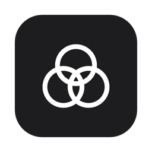

<p align="center">
  
</p>

# Hydra Desktop

The owner's Mac app: the Hydra interface in one window, and the Hydra Agent built in. The website stays the phone
version.

Hydra Desktop is a modified version of Roamies by Ken Kai (AGPL-3.0). See [NOTICE](NOTICE), [LICENSE](LICENSE) and
[THIRD_PARTY_NOTICES.md](THIRD_PARTY_NOTICES.md).

## What it does

- **The Hydra window.** Loads https://hydra-olive-one.vercel.app. It only goes to Hydra and its Supabase sign-in; other
  links open in the default browser. The sign-in cookie is kept on disk, so you stay signed in. Closing the window
  hides it; the Dock icon brings it back.
- **The Hydra Agent.** One character: an open sphere of ink dots that ripples with your voice and with its own. Talk
  (hold ⌃⌥, or say "Hey Hydra") or type (tap ⌥⌘). It answers in its Fish Audio voice, or in the Mac's voice until a
  Fish Audio key is added (panel, Speaking).
- **Sleep and wake.** After 5 minutes without talk it sleeps: speech recognition stops and nothing goes to the cloud.
  An on-device double-clap detector keeps listening; two claps 0.25 to 0.8 s apart wake it ("Hydra at your service,
  sir."). The sleep word (default "Hydra, sleep") puts it to sleep at once. Sensitivity and the sleep word are on the
  panel's Agent page.
- **Mac control.** Open apps, sites, files and folders; quit, hide, switch, close, minimise and arrange windows; click
  and type in apps. Off until "Allow file edits and commands" is on. Risky steps always ask: delete, send, pay, quit
  an app with unsaved work, close an unsaved window, force quit.
- **Hydra's data.** The Hydra agent API (Hydra PLAN U13) isn't built yet. The panel's Agent page holds its address
  and a device key (Keychain); Hydra's tools plug in at `showcase/tauri/sidecar/hydralink.mjs`.
- **Bridge for the web app.** `window.hydraDesktop` in the Hydra window: see [docs/BRIDGE.md](docs/BRIDGE.md).

## Install

Build the DMG (below) and open it. It is ad-hoc signed, not notarized (no Apple Developer ID yet): the first time,
right-click Hydra in Applications and pick Open, then Open again.

## Build

macOS on Apple silicon, with Rust, Node.js 22+, and the Xcode Command Line Tools:

```bash
cd showcase/tauri
(cd sidecar && npm ci && npm test)
./build.sh dev                                   # debug build
./build.sh release --target aarch64-apple-darwin --bundles app,dmg   # the DMG
```

The DMG lands in `showcase/tauri/src-tauri/target/aarch64-apple-darwin/release/bundle/dmg/`.

## Checks

```bash
cd showcase/tauri
(cd sidecar && npm test)
cargo test --locked --manifest-path src-tauri/Cargo.toml
src-tauri/binaries/roamies-voice-aarch64-apple-darwin --test-clap   # the double-clap detector
src-tauri/binaries/roamies-voice-aarch64-apple-darwin --test-wake   # "Hey Hydra" and the sleep word
src-tauri/binaries/roamies-hands-aarch64-apple-darwin --self-test
```

## Privacy

No telemetry, no crash reporting, no self-updater. See [PRIVACY.md](PRIVACY.md).
